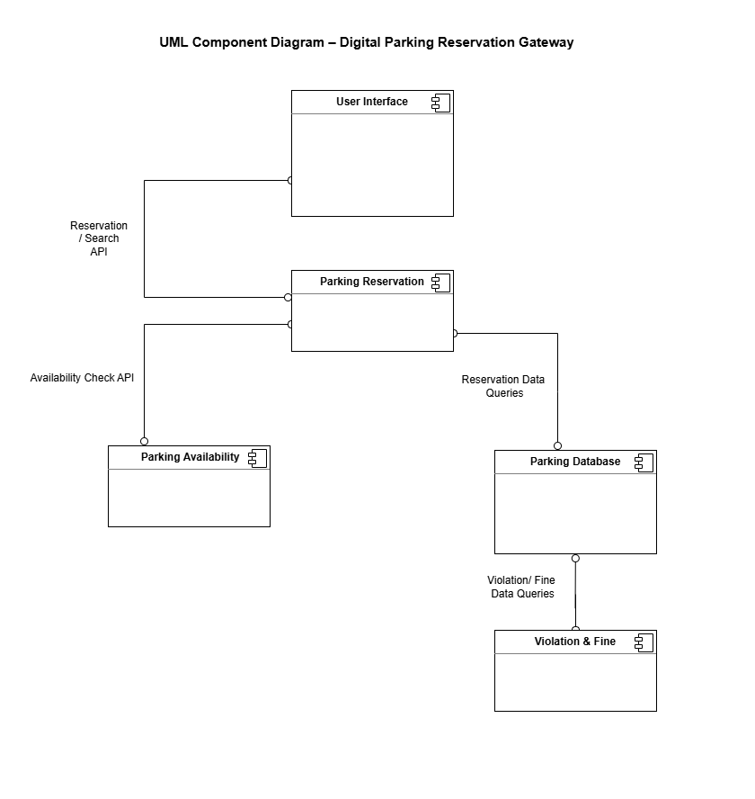

# Lab 3

## Component Modelling & Architectural Pattern Selection

The Digital Parking Reservation Gateway was modelled using a UML Component Diagram.
Client-Server Architecture was selected based on centralized management, data
consistency, security, and performance requirements.

### Deliverables
### 1. UML Component Diagram  
UML component diagram showing the five main components and their interfaces for the Digital Parking Reservation Gateway.  
   
  
### 2. Architectural Justification   
Justification for selecting the Client-Server architecture based on the system’s requirements.  
[Architectural Justification](../digital-parking-reservation-gateway/Lab3_Architectural_Justification.pdf)
